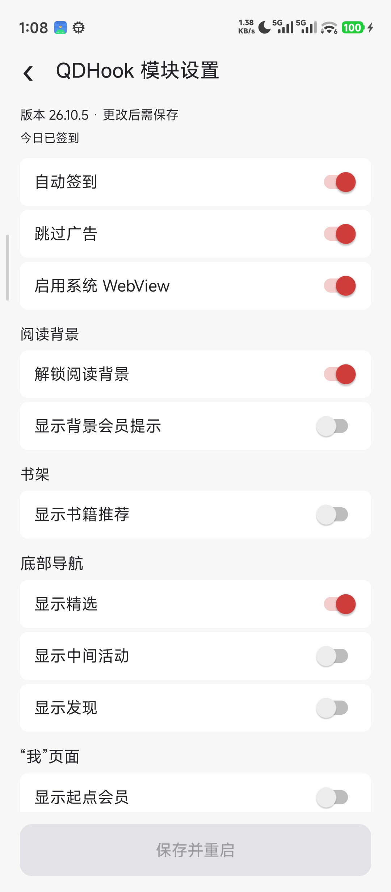
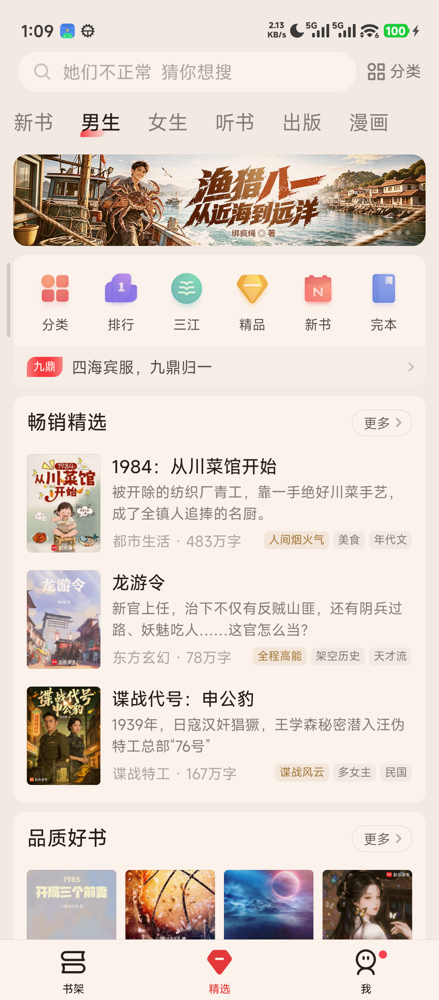

# tech.soyoren.qdhook

基于 **LibXposed API 102**，提供自动签到、广告相关、切换系统 WebView 和底部导航自定义功能

**模块包名：`tech.soyoren.qdhook`**

## 下载

前往本仓库的 [**Releases**](https://github.com/Xposed-Modules-Repo/tech.soyoren.qdhook/releases) 页面下载。

本仓库仅提供使用说明和 APK 发布，不公开源码。

## 兼容说明

- 需要支持 **LibXposed API 102** 的 LSPosed 环境。
- 适配目标为原包名 **`com.qidian.QDReader`** 的起点读书 **7.9.478**，修改包名的共存版本暂未适配。
- 设置入口：**起点读书 → 设置 → QDHook 模块设置**。
- 配置保存在起点读书的私有目录，模块更换包名后可保留已有设置。

### 测试环境

| 项目 | 版本 |
| --- | --- |
| Android | 15（SDK 35） |
| 架构 | arm64-v8a |
| KernelSU | 3.3.0 |
| Zygisk Next | 1.5.0 |
| LSPosed | 2.2.0（7854） |
| 起点读书 | 7.9.478 |

仅在上述环境测试通过，其他设备、系统及应用版本暂未验证。

## 使用方式

1. 下载并安装模块 APK。
2. 在 LSPosed 中启用 **QDHook**，作用域勾选 **起点读书**。
3. 强行停止起点读书后重新打开。
4. 进入 **设置 → QDHook 模块设置**，调整需要的功能或底部导航开关。
5. 点击底部 **保存并重启**，保存配置并重新打开起点。

“保存并重启”默认置灰，任一开关发生改动后亮起；全部改回原值后再次置灰。开关改动后需点击按钮保存，直接返回时可选择继续编辑或放弃更改。

部分 ROM 会提示“起点读书想要打开 QDHook”和“QDHook 想要打开起点读书”，需允许这两个方向的应用拉起。“本次允许”用于当次操作，“始终允许”由系统记住。若拒绝或等待首次确认超过 30 秒，可手动强行停止起点后重新打开，已保存配置仍会生效。

## 免责声明

- 本模块基于 Xposed 框架开发，会修改系统或应用行为，可能导致应用异常、设备不稳定、无法开机或数据损失。
- 使用本模块可能违反起点读书用户服务协议。请自行确认使用场景是否合法合规，并自行承担账号、设备和数据风险。
- 请确认下载渠道可信，不要使用来路不明的改包或二次分发包。
- 本模块不保证功能效果，不对任何直接或间接损失负责。
- 本模块仅供学习交流，请在下载 24 小时内删除；如不同意本文说明，请不要下载或使用。

## 截图

  
  

